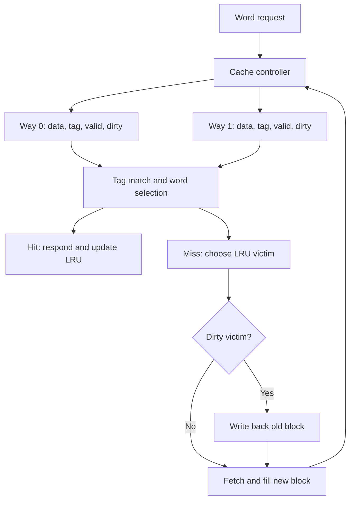

# MCA CacheLab

**2-Way Set-Associative Cache with LRU Replacement**  
Modern Computer Architecture | Maintained by Aditya Ranjan (`kvianAR`)

A verified Verilog cache study: compare a **2 KB direct-mapped cache** with a **2 KB two-way LRU cache**, exercise write-back data integrity, and run a 16-bit processor through either cache. The primary deliverable is the cache design and evaluation; CPU experiments demonstrate integration.

[Final technical report](docs/final_report.pdf) · [Measured results](docs/results.md) · [Architecture](docs/architecture.md) · [Verification](docs/verification.md) · [Viva guide](docs/viva.md) · [Source credits](SOURCES.md)

## Quick start

Requires Python 3.9+, GNU Make, and Icarus Verilog (`iverilog` and `vvp`). On macOS, install Icarus using `brew install icarus-verilog`; on Ubuntu use `sudo apt-get install iverilog make python3`.

```bash
git clone https://github.com/kvianAR/mca-project.git
cd mca-project
make test
```

`make test` runs component checks, eight CPU baseline configurations, cache unit/smoke/writeback tests, 6,000 trace accesses per cache, 2,358 mixed-word stress accesses per cache, and 36 CPU-cache configurations. Errors, missing inputs and missing PASS records fail the command.

| Command | Purpose |
|---|---|
| `make test-cache` | Main cache verification and direct-mapped comparison |
| `make test-integration` | Six CPU programs, both caches, memory latencies 1/3/6 |
| `make compare` | Original Harvard vs shared-memory cycle comparison |
| `make harvard PROG=prog4` | One Harvard baseline program |
| `make shared PROG=prog4` | One shared-memory baseline program |
| `make report` | Rebuild PDF and plots from measured CSVs |
| `make synth` | Yosys structural synthesis and checks for five top modules |

For report generation, install `python3 -m pip install -r requirements-report.txt`. Synthesis requires `yosys` on PATH, or `YOSYS=/path/to/yosys make synth`. The GitHub workflow installs the tools and runs simulation and structural synthesis separately.

## Cache design

| Parameter | Direct mapped | 2-way set associative |
|---|---|---|
| Address / word | 32-bit byte address / 32-bit data | Same |
| Line | 16 bytes, four words | Same |
| Data capacity | 2 KB | 2 KB |
| Organization | 128 lines | 64 sets x two ways |
| Tag / index / block offset | 21 / 7 / 4 bits | 22 / 6 / 4 bits |
| Replacement | Fixed indexed line | One LRU bit per set |
| Store policy | Write-back, write-allocate | Same |
| Backing store | 64 KB behavioral memory | Same |



The controller handles one outstanding transaction. CPU requests are latched; memory requests wait for `mem_ready`. Accesses are 32-bit aligned, with no byte write enables. Reset invalidates cache state; it does not flush dirty data.

## Measured results

Each trace contains 2,000 accesses, with a backing-memory latency parameter of 3 cycles.

| Trace | Direct-mapped hit rate | 2-way hit rate | DM cycles/access | 2-way cycles/access |
|---|---:|---:|---:|---:|
| Random | 3.35% | 3.00% | 10.83 | 9.69 |
| Locality | 88.35% | 89.40% | 3.06 | 1.90 |
| Conflict | 0.00% | 99.90% | 10.00 | 1.01 |


The conflict trace alternates `0x00000000` and `0x00000800`: the baseline repeatedly evicts the other block; two ways retain both after two cold misses. Random traffic exceeds capacity, so associativity does not improve its hit rate. These numbers are measured, not guaranteed for arbitrary workloads.

**Cycle interpretation:** the inherited trace driver excludes request acceptance and idle gaps. The two controllers have different ready/output timing, so cycle differences include implementation choices as well as miss patterns. No FPGA Fmax or area advantage is inferred from this table.

## CPU integration

The original 16-bit CPU supports HALT, ADD, LOAD, STORE, SUB, ADDI, BEQ and JMP. A new blocking bridge connects it to either unified cache. Each CPU word maps to a 32-bit cache slot at `byte_address = word_address * 4`; only the low 16 bits carry CPU data. I/O at word address `0x3F` and invalid regions bypass caching.

- The CPU is stalled during fetch/data transactions and commits once per completed instruction.
- A golden interpreter checks the instruction, all eight registers, PC, I/O, error flag and HALT after every retirement.
- Programs 1-4 preserve the original baseline; program 5 adds store/readback and I/O/invalid/R0 checks; program 6 tests self-modifying code through the unified cache.
- The CPU has only 64 word addresses. Its working set fits in either cache; these tests prove integration, while large standalone cache traces demonstrate associativity.

The original Harvard/shared experiment remains reproducible: cycles are `5/8`, `4/7`, `4/4`, and `23/27` for programs 1-4. Its idealized formula is `shared cycles = Harvard cycles + executed LOAD/STORE count`; it does not describe the cached bridge.

## Repository map

| Location | Contents |
|---|---|
| `cache/rtl/` | Cache controllers, ways, tags, valid bits, LRU, memory model |
| `cache/tb/`, `cache/sim/traces/` | Cache verification and deterministic workloads |
| `rtl/`, `tb/`, `programs/` | CPU baseline and programs |
| `integration/rtl/`, `integration/tb/` | New CPU-cache integration and golden interpreter |
| `scripts/` | Fail-closed verification, measured reports, structural synthesis |
| `results/` | Measured CSVs and synthesis evidence |
| `docs/` | Final report, plots, architecture, verification and viva guide |
| `.github/workflows/` | Automated verification and synthesis |

`cache/README.md`, `cache/docs/`, `cache/report/`, `cache/synth/`, and `docs/original_*` retain upstream historical documents. The root documentation is authoritative for this combined project. The inherited two-way Vivado figures are flagged as inconsistent upstream and are not final project measurements.

## Scope and attribution

The simulation and integration deliverables are complete and reproducible. Physical FPGA deployment, place-and-route timing, power measurement, nonblocking misses and multicore coherence are outside this submission. Structural synthesis is distinct from physical FPGA implementation; see its logs/CI artifacts for status.

This repository builds on the two credited source revisions in [SOURCES.md](SOURCES.md). New work includes the CPU-cache bridge, CPU line memory, per-retirement reference checking, mixed-word cache stress tests, fail-closed tooling, consolidated analysis and submission documentation. No official Phase 2 rubric was provided; completion claims here refer to these listed deliverables.
