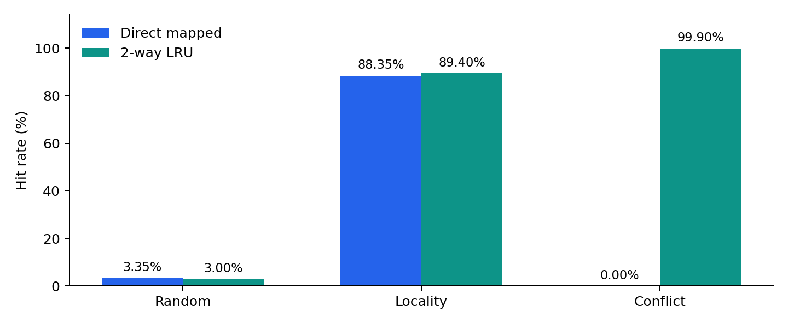
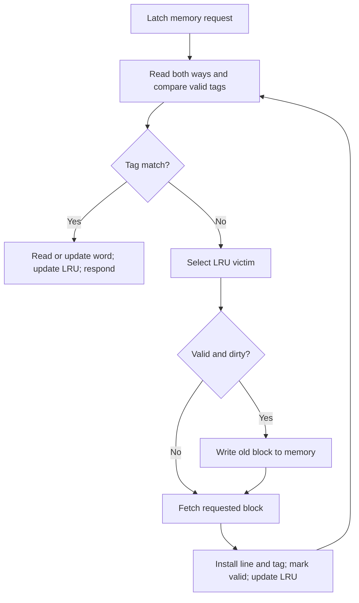

<div align="center">

# MCA CacheLab
### 2-Way Set-Associative Cache with LRU Replacement

**Design it. Verify every read. Measure the trade-offs.**

[](https://github.com/kvianAR/mca-project/actions/workflows/verify.yml)


[Technical Report](docs/final_report.pdf) · [Results](docs/results.md) · [Architecture](docs/architecture.md) · [Verification](docs/verification.md) · [Viva Guide](docs/viva.md)

</div>

---

## The project

MCA CacheLab implements a **2-way set-associative cache with LRU replacement** and compares it with an equal-capacity **direct-mapped cache**. Both designs run the same memory workloads and are checked against an independent golden memory model.

The project covers the full access path: tag lookup, hit selection, allocation, dirty eviction, writeback and block refill. A supporting experiment connects a 16-bit processor to either cache through a request/commit bridge.

- **Equal-capacity comparison:** 2 KB of data and 16-byte lines in both caches.
- **Verified data integrity:** 8,358 cache workload operations per design, including mixed-word writeback stress.
- **Working CPU integration:** 36 configurations, with every retired instruction checked against an architectural interpreter.
- **Reproducible evidence:** measured CSVs, plots, a final PDF report and automated simulation/structural synthesis.

## Project team

| Member | Name | Enrollment number | Assigned role |
|:---:|:---|:---|:---|
| 1 | Satwik | | Direct-mapped baseline, cache data RAM and tag RAM |
| 2 | Aditya Ranjan | 2401010035 | 2-way cache controller, LRU replacement and top-level integration |
| 3 | Ashar Asif Shaikh | | Backing memory, CPU-cache bridge and memory-mapped I/O |
| 4 | Aryan Singh Rathore | | Verification, benchmark analysis, report and CI |

## Results at a glance

Each benchmark contains **2,000 accesses**. The backing-memory latency parameter is **3 cycles**.

| Workload | Direct-mapped hits | 2-way LRU hits | DM cycles/access | 2-way cycles/access |
|:---|---:|---:|---:|---:|
| Random | 3.35% | 3.00% | 10.83 | 9.69 |
| Locality | 88.35% | 89.40% | 3.06 | 1.90 |
| Conflict | 0.00% | **99.90%** | 10.00 | **1.01** |



The conflict workload alternates `0x00000000` and `0x00000800`. A direct-mapped cache repeatedly evicts the other block. Two ways retain both after the first two compulsory misses, producing **1,998 hits out of 2,000 accesses**.

Associativity does not always help: the random workload exceeds cache capacity and has little reuse. Its measured two-way hit rate is slightly lower.

> **How to read the timing:** the trace driver excludes request acceptance and inter-request idle gaps. The two controllers also differ in ready/output timing. Cycles/access therefore includes controller implementation effects; it is not a pure associativity comparison or an FPGA frequency claim.

[See the complete measured results →](docs/results.md)

## Run the project

### Requirements

- Python **3.9+**
- GNU Make
- Icarus Verilog: `iverilog` and `vvp`

```bash
# macOS
brew install icarus-verilog

# Ubuntu / Debian
sudo apt-get install iverilog make python3
```

### Clone and verify

```bash
git clone https://github.com/kvianAR/mca-project.git
cd mca-project
make test
```

For this private repository, clone using an account with access.

| Command | What it runs |
|:---|:---|
| `make test` | Complete CPU, cache and integration verification |
| `make test-cache` | Cache unit tests, golden-model traces and mixed-word stress |
| `make test-integration` | Six CPU programs through both caches at three memory latencies |
| `make compare` | Original Harvard vs shared-memory cycle comparison |
| `make harvard PROG=prog4` | One Harvard CPU program |
| `make shared PROG=prog4` | One shared-memory CPU program |
| `make demo` | Live cache demonstration and measured comparison |
| `make report` | Generate the final PDF and charts from measured CSVs |
| `make synth` | Run Yosys structural checking for five top modules |

Tests stop with a nonzero exit status on compiler errors, mismatches, missing inputs, incomplete results or timeouts. Generated logs and waveforms stay in build directories; measured CSVs are in [`results/`](results/).

## Cache architecture

| Design choice | Direct mapped | 2-way set associative |
|:---|:---|:---|
| Address / data | 32-bit byte address / 32-bit word | Same |
| Data capacity | 2 KB | 2 KB |
| Cache line | 16 bytes, four words | Same |
| Organization | 128 lines | 64 sets × 2 ways |
| Tag / index / offset | 21 / 7 / 4 bits | 22 / 6 / 4 bits |
| Replacement | One fixed line per index | One LRU bit per set |
| Store policy | Write-back, write-allocate | Same |
| Backing memory | 64 KB, configurable response latency | Same |



The controller accepts **one outstanding request**. Each set stores two valid bits, two dirty bits and one LRU bit. Accessing way `W` makes the other way the next victim. A dirty victim is written back before the replacement block is installed.

The validated configuration uses word-aligned accesses and the default cache geometry. Byte stores, arbitrary geometry combinations, nonblocking misses and multicore coherence are outside its interface contract. Reset invalidates cache state and **does not flush dirty lines**.

[Read the implementation contract →](docs/architecture.md)

## Verification coverage

| Layer | Scope | Result |
|:---|:---|:---|
| Cache submodules | Data/tag RAM, valid bits, LRU and tag comparison | PASS |
| Cache controllers | Cold misses, hits, allocation, conflicts and dirty writeback | PASS |
| Backing memory | Request latching and ready timing at latency 1 / 3 / 6 | PASS |
| Golden-model benchmarks | 6,000 trace operations per cache; compare every read | **Zero mismatches** |
| Additional word stress | 2,358 operations per cache; four word offsets, dirty conflicts and capacity readback | PASS |
| CPU components | Registers, R0 protection, PC controls and all 64 decoded addresses | PASS |
| Original CPU baseline | Four programs × two memory organizations | **8 / 8 PASS** |
| CPU-cache integration | Six programs × two caches × three memory latencies | **36 / 36 PASS** |
| Structural synthesis | Five top modules checked with Yosys 0.52 | **5 / 5 PASS** |

The GitHub workflow repeats these checks in a clean environment, checks that measured CSVs reproduce exactly, and injects a compiler failure to verify failure propagation. [Open the latest runs →](https://github.com/kvianAR/mca-project/actions)

## Processor integration

A blocking bridge connects the original **16-bit, eight-register CPU** to either unified cache. Its ISA includes `HALT`, `ADD`, `LOAD`, `STORE`, `SUB`, `ADDI`, `BEQ` and `JMP`.

The bridge fetches an instruction, performs any data transaction, and releases CPU stall for one commit edge. Each CPU word occupies the low half of a 32-bit cache slot:

```text
cache byte address = CPU word address × 4
```

Memory-mapped output at CPU address `0x3F` and invalid addresses `0x30–0x3E` bypass the cache. The reference interpreter checks the instruction, all registers, PC, output, error flag and HALT on every retirement.

| Program | Purpose |
|:---|:---|
| `prog1` | Load 5 and 7, add them, and store 12 |
| `prog2` | Output-register write and invalid-address handling |
| `prog3` | Arithmetic-only baseline control |
| `prog4` | Subtraction, immediate values, countdown loop and branches |
| `prog5` | Store/load readback, I/O readback, invalid accesses and R0 protection |
| `prog6` | Modify a future instruction and execute the updated code |

The CPU's 64-word working set fits in either cache. These programs demonstrate **integration correctness**; the larger standalone cache traces demonstrate conflicts and replacement.

The original Harvard/shared experiment remains available: program 1 takes **5 vs 8 cycles**, program 2 **4 vs 7**, program 3 **4 vs 4**, and program 4 **23 vs 27**. Its idealized cycle equation does not apply to the multicycle cached bridge.

## Reports and synthesis

```bash
# Regenerate the technical report and figures after verification
python3 -m pip install -r requirements-report.txt
make report

# Requires yosys on PATH; alternatively set YOSYS=/path/to/yosys
make synth
```

The final report is [`docs/final_report.pdf`](docs/final_report.pdf). Structural synthesis scripts, raw logs and the tool-version summary are committed under [`results/synthesis/`](results/synthesis/).

All five top modules passed `hierarchy`, `proc`, `opt`, `check` and `stat` in GitHub CI. The two-way hierarchy retains **19,200 data/tag memory bits**, consistent with its declared storage. These are generic RTL statistics. Physical FPGA deployment, place-and-route timing, power and validated Fmax are not claimed.

## Navigate the source

| Location | Contents |
|:---|:---|
| [`cache/rtl/`](cache/rtl/) | Main cache design and direct-mapped baseline |
| [`cache/tb/`](cache/tb/) | Cache unit, comparison and writeback stress tests |
| [`cache/sim/traces/`](cache/sim/traces/) | Deterministic benchmark inputs |
| [`integration/`](integration/) | CPU-cache bridge, line memory and architectural interpreter |
| [`rtl/`](rtl/), [`tb/`](tb/), [`programs/`](programs/) | CPU baseline, verification and programs |
| [`scripts/`](scripts/) | Verification, demo, report and synthesis tooling |
| [`results/`](results/) | Measured CSVs and structural synthesis evidence |
| [`docs/`](docs/) | Final report, architecture, verification, submission and viva notes |

## Credits and project scope

Maintained by **Aditya Ranjan — [kvianAR](https://github.com/kvianAR)**.

The cache and CPU baselines come from the revisions credited in [SOURCES.md](SOURCES.md). Integration work adds the CPU-cache bridge, latency-controlled CPU line memory, architectural reference checking, mixed-word cache stress tests, consolidated analysis, report generation and CI.

Root documentation describes the final combined project. Documents under `cache/report/`, `cache/docs/`, `cache/synth/` and `docs/original_*` retain upstream history; inherited Vivado figures marked as needing a rerun are not final-project measurements. Course phase compliance should be checked against the official rubric.
